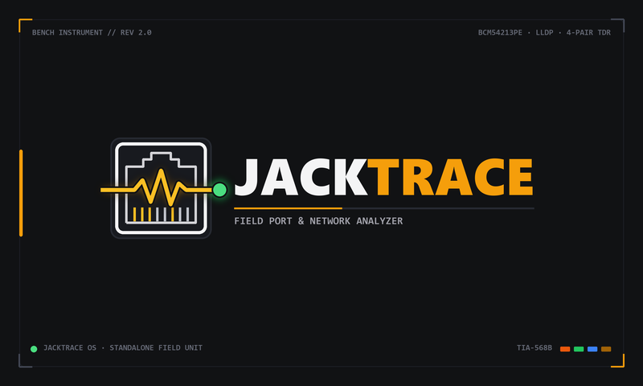
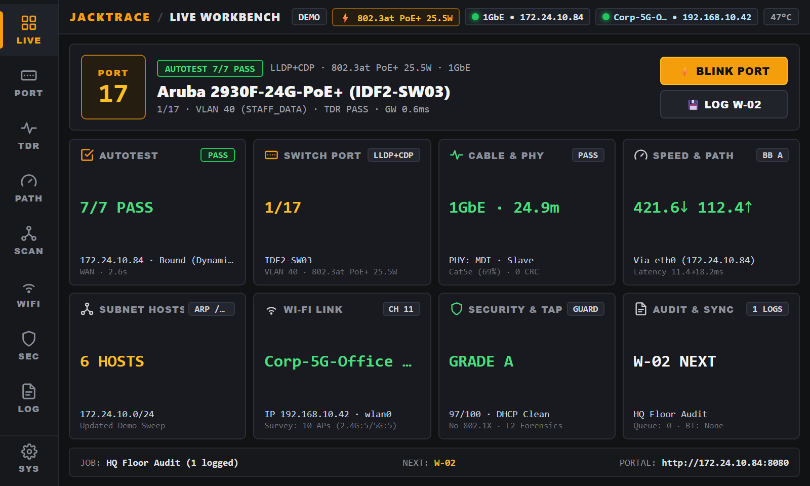
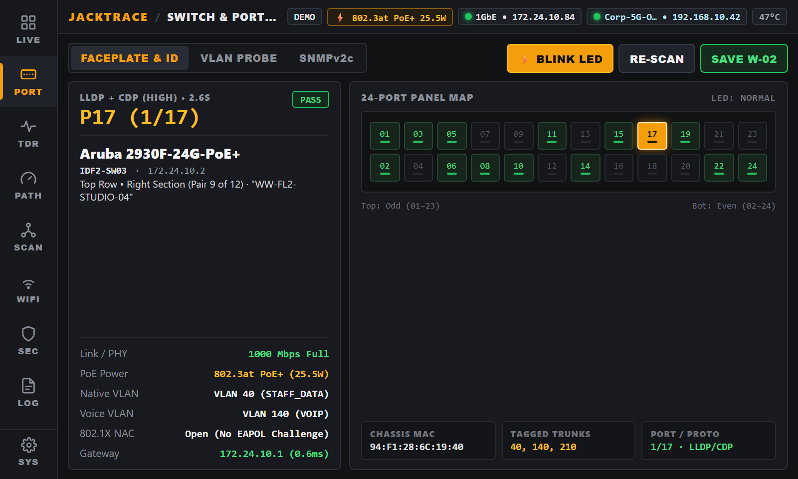
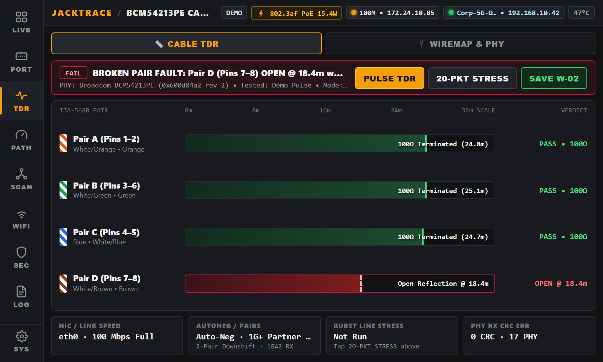
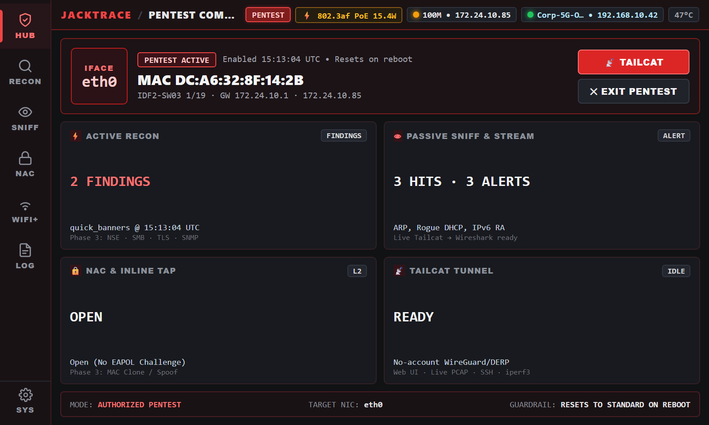
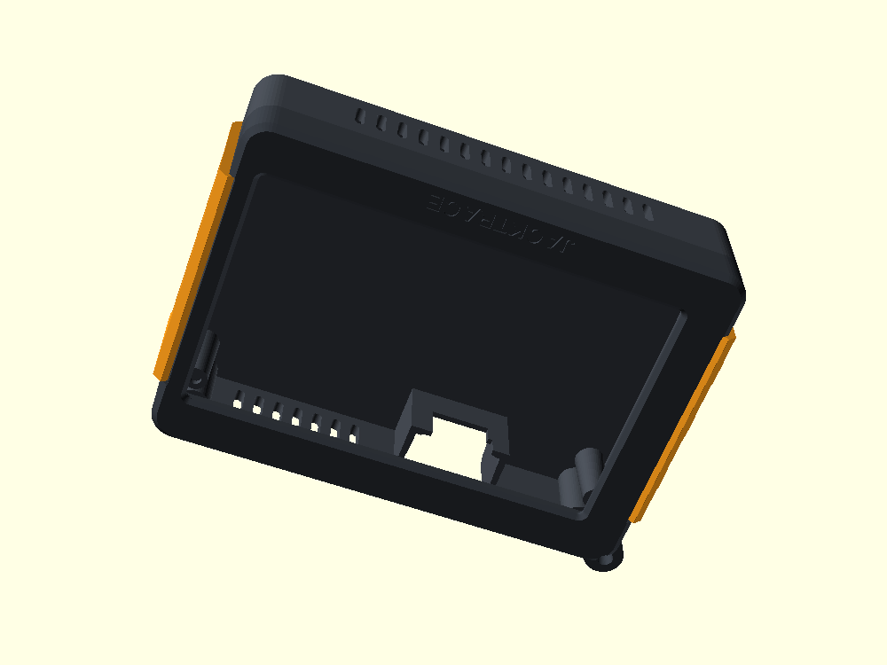
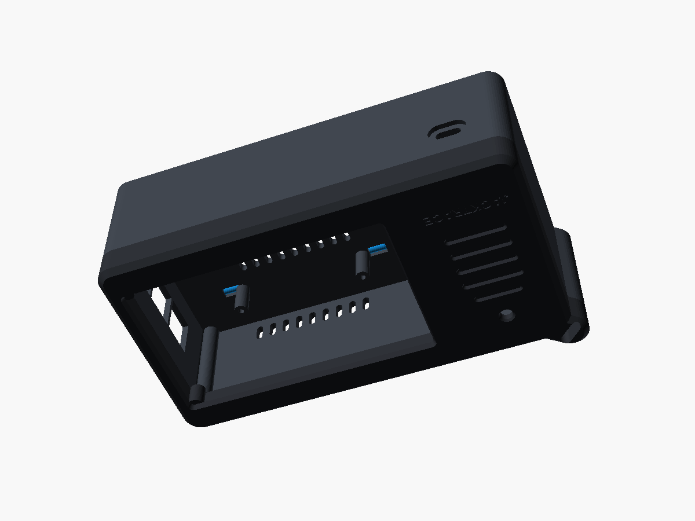

# JackTrace — Open-Source Raspberry Pi 4 Handheld Network Analyzer

<p align="center">
  
</p>

**JackTrace** turns a **Raspberry Pi 4 Model B**, a **Waveshare 5" DSI capacitive touchscreen (`800×480`)**, and a **USB-C power bank** into a self-contained handheld field network analyzer — built to trace wall jacks to switch ports, test physical Ethernet pairs down to the Broadcom PHY register level, measure LAN/WAN throughput and Wi-Fi coverage, capture Layer-2 forensics and authorized pentest audits, print 58 mm thermal drop labels, and sync floor audits directly to NetBox or a custom Webhook.

Designed for one-handed field troubleshooting inside comms cabinets and floor audits, JackTrace runs a zero-scroll **`800×480` Wayland kiosk UI** with an embedded QWERTY + IP Numpad touch keyboard, plus a separate **Crimson Authorized Pentest Mode** and zero-account **Tailcat WireGuard/DERP remote tunneling**.

---

## Documentation Map

| Document | Scope |
| :--- | :--- |
| [**Field Features & Standard Workbench**](docs/features.md) | Live Workbench, 7-Stage AutoTest, Switch Faceplate ID & LED Blinker, Hardware Cable TDR & Software Wiremap/PHY, WAN Speed/Bufferbloat/`iperf3`, Subnet Scanner & WoL, Wi-Fi Survey, L2/DHCP Forensics, Audit PDF/CSV/JSON/PCAP, Webhook/NetBox Sync, 58 mm Bluetooth Printer & `SYS` Controls |
| [**Authorized Pentest Mode & Tailcat Remote**](docs/pentest-and-remote.md) | Opt-in Crimson Workbench, Active Recon (`nmap` NSE / SMB / TLS / SNMP defaults), Passive LLMNR/NBT-NS/WPAD & Cleartext Credential Sniffer, Dual-NIC `br0` Tap & Temporary MAC Clone/Spoof, External USB Wi-Fi Rogue AP / Evil Twin Watch, and Tailcat Ephemeral Tunnels |
| [**Hardware, Enclosures, Setup & API**](docs/hardware-and-setup.md) | Hardware BOM, Dual-Input PoE + USB-C Power Architecture, Provisioning Scripts, Systemd Services, Environment Variables, Module Architecture, REST/WebSocket API Reference & Test Suite |
| [**Minimal Field Bumper Enclosure**](enclosure/minimal/01_field_bumper/README.md) | Slim `137.6 × 93.0 × 38.5 mm` support-free 3D-printed shell with captured side bumper rails and stick-on MagSafe power bank recess (zero soldering) |
| [**Extended-Grip Enclosure & PoE Build Guide**](enclosure/BUILD_GUIDE.md) | `173.3 × 96.0 × 63.3 mm` A work in progress - ideas for a rugged shell with PiSugar 3 Plus UPS, Waveshare PoE HAT (C), Dual Ideal Diode OR-ing, kickstand, and room for PoE sensing hardware |

---

## At-a-Glance Capabilities

### Switch & Port Identification
- **Multi-Protocol Neighbor Discovery:** Passive `lldpd` (`LLDP`, `LLDP-MED`, `Cisco CDP`, `Extreme EDP`, `Foundry FDP`, `Nortel SONMP`) fused with a native `AF_PACKET` Layer-2 sniffer.
- **Interactive Switch Faceplates:** Parses port strings (e.g. `Gi1/0/24`, `Ethernet1/0/49`, `eth1/0/5`) onto 8-, 16-, 24-, or 48-port faceplate maps with PoE/PoE+ wattage TLVs, Native/Voice/Tagged VLAN badges, and 802.1X EAPOL detection.
- **Credential-Free LED Port Blinker:** Pulses link speed (`1G / 100M / Off` or `On / Off`) so you can spot the live switch port inside a crowded cabinet without switch admin credentials.
- **802.1Q VLAN Trunk Prober & SNMPv2c:** Safe non-lease `DHCPDISCOVER` probes over ephemeral `eth0.<vid>` subinterfaces with guaranteed teardown, plus a manual-tap pure-Python BER/ASN.1 SNMPv2c reader.

### Physical Cable TDR & PHY Integrity
- **Broadcom `BCM54213PE` Hardware TDR:** Drives Enhanced Cable Diagnostics directly over Linux MDIO ioctls to measure all 4 TIA-568B pairs (Pins `1–2`, `3–6`, `4–5`, `7–8`) as `OK`, `OPEN`, `SHORT`, or `CROSS-SHORT` in meters — even on **dead/unpatched wall sockets**.
- **Cable Jacket NVP Calibration:** Built-in presets for `Cat5e (69%)`, `Cat6 (72%)`, `Cat6A (76%)`, or custom `55–85%` NVP scaling.
- **Software Wiremap & PHY Integrity:** Non-disruptive live register decoding across IEEE `0x0A` (`MII_STAT1000` Master/Slave, Local/Remote RX OK, 1G Idle Errors) and Broadcom `0x11`–`0x14` (`Auto-MDIX` pin role, descrambler lock, RX symbol, false carrier, RX `NOT_OK`), and 20-packet burst stress testing.

### Throughput, Latency & Path Diagnostics
- **7-Stage Plug-In AutoTest:** Evaluates Physical Link, Switch ID, IPv4/DHCP, Default Gateway, DNS Resolver, Internet/Captive Portal, and Security/NAC using **Standard WAN** or **LAN-Only** profiles, with optional **Auto-Log** to the active audit job.
- **Live Ping, Traceroute & PMTU:** Continuous ICMP monitor with canvas sparkline, min/avg/max RTT and jitter, hop-by-hop Traceroute, and Path MTU / Jumbo Frame (`DF`) discovery.
- **Interface-Bound Cloudflare WAN Speed + Bufferbloat:** Measures download/upload Mbps and loaded vs. unloaded latency (`A+`–`F` Bufferbloat grade) with an explicit **Interface Selector** (`Auto Route` | `ETH` | `Wi-Fi`).
- **LAN `iperf3` Client & Server:** Saved LAN target chips plus a toggleable local `:5201` `iperf3` server.

### Discovery & Wireless
- **Subnet Scanner & Host Deep Dive:** Fast `/24` sweep (`arp-scan` + kernel ARP fallback) with offline MAC OUI vendor lookup, rDNS + NetBIOS (`UDP/137`) hostname resolution, and role inference. Tapping any host opens a **17-port TCP Deep Dive** modal with HTTP `<title>` scraping, mDNS hints, Ping/Trace shortcuts, and **Wake-on-LAN**.
- **Wi-Fi Site Survey & Client Manager:** `iw`-backed `2.4 GHz` & `5 GHz` survey, Channel Overlap Graph with best-channel recommendation, 60-sample Signal Walk Meter, and a WiFi client switcher.

### Security, L2 Forensics & Authorized Pentest Mode
- **Automated `0–100` (`A`–`F`) Security Posture:** Broadcast Rogue DHCP trap (non-lease `DHCPDISCOVER`), passive ARP duplicate-IP/MITM conflict monitor, STP/RSTP Root Bridge & BPDU decoding, Broadcast/Multicast PPS storm detection, IPv6 RA Guard, and DHCP option inspection (`Opts 1, 3, 6, 15, 42, 43, 51, 66, 67, 119, 150, 252`).
- **One-Tap `.pcap` & Dual-NIC Inline Tap (`br0`):** Record `15s`, `60s`, or continuous (`100 MB` cap) Wireshark captures, or bridge two wired NICs (e.g. `eth0` + USB `2.5GbE`) into a transparent Layer-2 inline tap forwarding LLDP and 802.1X EAPOL with `net.ipv4.ip_forward=0`.
- **Gated Authorized Pentest Mode:** Explicit opt-in crimson workbench (resets to Standard Mode on reboot) adding **Active Recon** (`nmap` NSE / SMB signing / TLS cipher / SNMP defaults), **Passive Poisoning & Cleartext Sniffer** (LLMNR/NBT-NS/WPAD/mDNS + redacted HTTP Basic/FTP/Telnet/SNMP/NTLMSSP/SMBv1/Mail/MQTT/SIP), **MAC Clone/Spoof** with persistent hardware MAC recovery, and **Rogue AP / Evil Twin Watch**. See [`docs/pentest-and-remote.md`](docs/pentest-and-remote.md).

### Audit Reporting, Integrations & Ephemeral Remote Access
- **Multi-Job SQLite Audit Logger & QR Portal:** Save wall drops with quick prefixes (`W-`, `AP-`, `CAM-`, `SW-`, `DESK-`) and touch notes; export **landscape PDF** (with built-in touch viewer), **CSV**, and **JSON**; scan the on-screen QR code (over LAN or opt-in `JackTrace-AP` hotspot) to pull reports straight to a phone.
- **Webhook (JSON) & NetBox DCIM Sync:** Push drops or Tailcat sessions to any HTTP/Bearer webhook or automatically match and patch NetBox `/api/dcim/interfaces/` descriptions — backed by a persistent SQLite offline retry queue (`sync_queue`, 30s background worker) and masked server-side tokens.
- **Bluetooth 58 mm Thermal Printer:** Pairs via BlueZ (`AF_BLUETOOTH` RFCOMM) to print wall-drop labels and live port receipts complete with hardware `GS ( k` QR codes and a 32-column touchscreen preview.
- **Tailcat Ephemeral WireGuard/DERP Tunnels:** Expose the JackTrace Web UI, live Wireshark `tcpdump` pipe, `iperf3`, or key-only SSH over zero-account `tc...` addresses with scannable QR codes and optional Webhook notification.

---

## Touchscreen UI Architecture

JackTrace renders natively at **`800×480`** in a Wayland `cage` + Chromium kiosk (`?kiosk=1`) with an invisible cursor theme and an embedded QWERTY / symbol / IP Numpad modal (`#kb-modal`) for password/token/target entry:

- **Top Status Bar:** Mode badge (`LIVE` / `PENTEST`), Tailcat tunnel badge (`TC`), PoE badge (`PoE+`), Ethernet link/IP pill (`eth0`/`eth1`), Wi-Fi link/IP pill (`wlan0`), and `SYS` shortcut.
- **Left Instrument Rail:**
  - *Standard Mode:* `LIVE` (`view-home`), `PORT` (`view-sw`), `TDR` (`view-link`), `PATH` (`view-diag`), `SCAN` (`view-scan`), `WIFI` (`view-wifi`), `SEC` (`view-sec`), `LOG` (`view-audit`), plus `SYS` modal (`DISPLAY & POWER`, `WI-FI`, `IP & CAL`, `NICs & TAP`, `REMOTE`).
  - *Authorized Pentest Mode:* `HUB` (`view-pt-hub`), `RECON` (`view-pt-recon`), `SNIFF` (`view-pt-sniff`), `NAC` (`view-pt-nac`), `WIFI+` (`view-pt-wifi`), `LOG` (`view-audit`), plus `SYS`.

### UI Screenshots (Demo Mode)

<p align="center">
  
  &nbsp;&nbsp;
  
</p>
<p align="center">
  
  &nbsp;&nbsp;
  
</p>

More screen captures (including Wiremap &amp; PHY, WAN Speed, Wi-Fi Channel Overlap, and Passive Exposure Sniffing) are available in [`docs/features.md`](docs/features.md) and [`docs/pentest-and-remote.md`](docs/pentest-and-remote.md).

---

## Hardware & 3D-Printable Enclosures

| Build Option | Dimensions | Power Architecture | Guide |
| :--- | :--- | :--- | :--- |
| **Minimal Field Bumper** *(Concept 1)* | `137.6 × 93.0 × 38.5 mm` (`~47.5 mm` w/ MagSafe) | Direct Pi 4B + Waveshare 5" DSI LCD powered by USB-C / MagSafe power bank (zero soldering, captured TPU/PETG bumper rails) | [`enclosure/minimal/01_field_bumper/README.md`](enclosure/minimal/01_field_bumper/README.md) |
| **Extended-Grip Enclosure** | `173.3 × 96.0 × 63.3 mm` | NOT TESTED OR COMPLETE! **PiSugar 3 Plus** (5000 mAh UPS) + **Waveshare PoE HAT (C)** (GPIO pins 2 & 4 isolated) + **Dual Ideal Diode OR-ing** for simultaneous USB-C + 802.3af/at PoE without breaking TDR | [`enclosure/BUILD_GUIDE.md`](enclosure/BUILD_GUIDE.md) |

<p align="center">
  
  &nbsp;&nbsp;
  
</p>

---

## Quick Start

### 1. Local Desktop Demo Mode (Windows / macOS / Linux)
On non-Linux hosts, JackTrace starts in **Demo Mode** automatically (or force it on Linux with `NETTESTER_DEMO=1`)
You can download or clone the repo and on Windows start a local demo instance with:

```powershell
python -m venv .venv
.\.venv\Scripts\pip install -r requirements.txt
.\.venv\Scripts\uvicorn app.main:app --host 0.0.0.0 --port 8080
```

Open `http://localhost:8080` to use the `800×480` simulator + desktop **Bench Bar** with 4 built-in demo scenarios (`healthy_1g`, `pair_fault_100m`, `nac_8021x_locked`, `unpatched_dead`), append `?kiosk=1` for fixed `800×480` touchscreen mode, or `?mode=app` for responsive laptop/UMPC fullscreen (e.g. GPD Pocket 3).

### 2. Provision on Raspberry Pi 4 or x86_64 Linux (e.g. GPD Pocket 3)

On **Raspberry Pi OS Lite** (Bookworm / Trixie):

```bash
cd ~/jacktrace
sudo bash scripts/setup_pi.sh eth0        # System networking tools, lldpd, tailcat (optional), .venv, pi-nettester.service
sudo bash scripts/setup_kiosk.sh          # Waveshare 5" DSI KMS + Cage Wayland + Chromium kiosk (pass --flip for 180°)
sudo bash scripts/setup_splash.sh         # Optional 800x480 Plymouth boot/shutdown splash + seamless DRM handoff
```

On **x86_64 Debian 13 (Trixie) / Ubuntu** (including **GPD Pocket 3**):

```bash
cd ~/jacktrace
sudo bash scripts/setup_x86.sh --profile gpd-pocket3 --mode desktop   # or --mode kiosk
```

See [`docs/hardware-and-setup.md`](docs/hardware-and-setup.md) for x86_64/GPD Pocket 3 details and hardware TDR caveats.

### 3. Stream Updates from Windows PowerShell to Pi

```powershell
cmd /c "tar --exclude=.venv --exclude=.pytest_cache --exclude=__pycache__ --exclude=data -czf - . | ssh jacktrace ""mkdir -p ~/jacktrace && tar -xzf - -C ~/jacktrace""" ; if ($LASTEXITCODE -eq 0) { ssh jacktrace "sudo systemctl restart pi-nettester.service jacktrace-kiosk.service && sleep 3 && systemctl is-active pi-nettester jacktrace-kiosk" }
```

### 4. Run the Automated Test Suite (**52 tests** across 12 test modules)

```powershell
.\.venv\Scripts\python.exe -m pytest -v
```

---

## Safety, Legal & Authorized-Use Guardrails

- **Authorized Networks Only:** Pentest Mode is intended solely for networks you own or have explicit written authorization to audit. It is **disabled by default on every boot**, gated behind an explicit confirmation modal (`authorized_ack=true`), and enforced server-side (`HTTP 403` when inactive).
- **No Unintended Routing / Bridging:** `net.ipv4.ip_forward=0` is enforced across setup, Field AP toggling, and Dual-NIC `br0` Inline Tap teardown.
- **No Orphaned State:** Ephemeral `eth0.<vid>` VLAN subinterfaces, `br0` tap bridges, temporary `wpa_supplicant` `/tmp` configs (`0600`), Tailcat `tcpdump` pipes, and spoofed MAC addresses are automatically torn down or restored on stop, mode change, or service shutdown.
- **Credential Hygiene:** Wi-Fi passphrases, 802.1X EAP passwords, Webhook Bearer tokens, and NetBox API tokens are never emitted in API/WebSocket snapshots, and passive cleartext password captures are redacted before storage.

---

## License

Released under the [MIT License](LICENSE).
