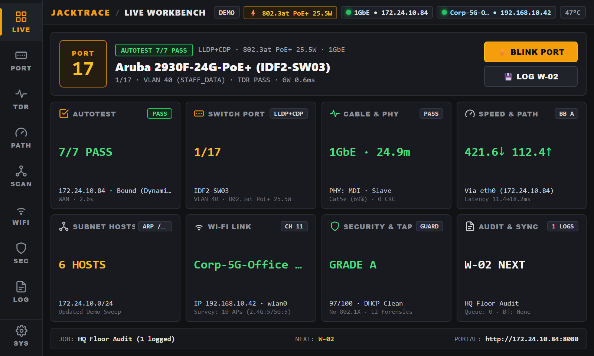
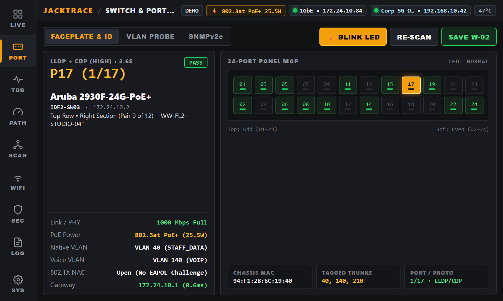
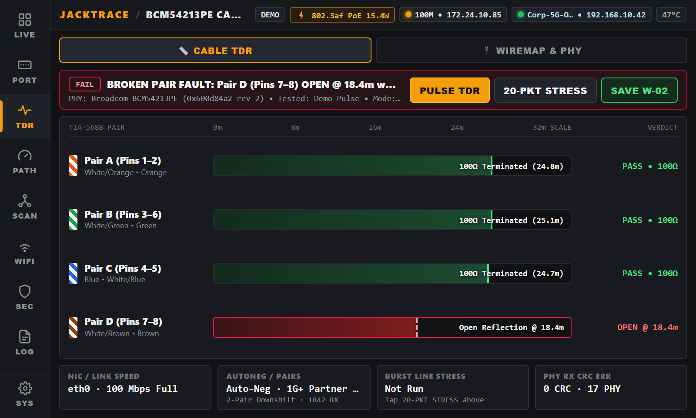
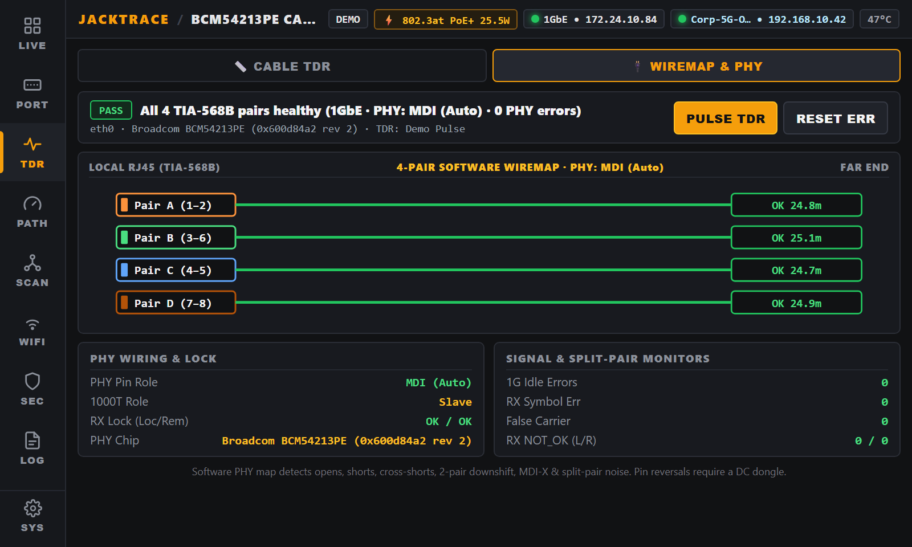
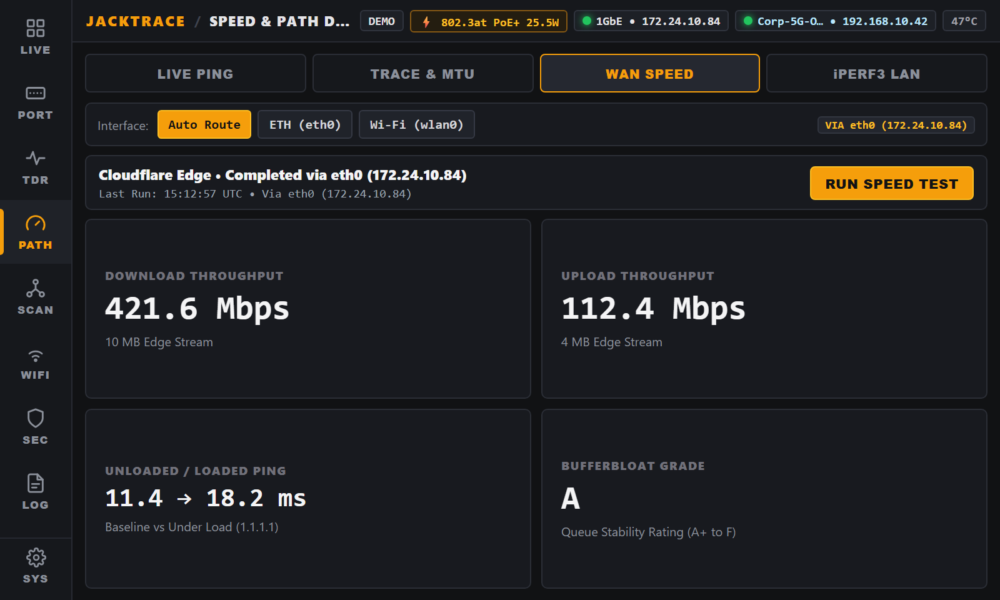
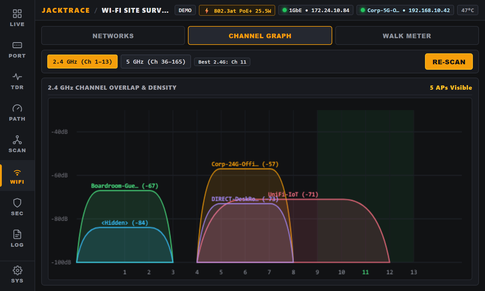

# JackTrace — Standard Mode Field Diagnostics & Features

This guide documents every instrument view, diagnostic test, export pipeline, and system control available in JackTrace Standard Mode (**8 main views + 5-tab `SYS` modal**), designed specifically for an **`800×480` capacitive touchscreen** with zero vertical scrolling on primary views.

> Looking for Authorized Pentest Mode or Tailcat remote tunneling? See [**`docs/pentest-and-remote.md`**](pentest-and-remote.md).
> Looking for BOMs, enclosures, Pi setup scripts, or the REST/WebSocket API? See [**`docs/hardware-and-setup.md`**](hardware-and-setup.md).

---

## Navigation, Status Bar & Touch Keyboard

### Topbar Status Pills
| Pill | Function | Tap Action |
| :--- | :--- | :--- |
| **`LIVE` / `PENTEST`** | Shows active instrument mode (`LIVE` cyan or `PENTEST` crimson) | Opens Pentest Authorization Gate (or exits Pentest Mode) |
| **`TC`** | Appears when a Tailcat WireGuard/DERP tunnel is running | Jumps straight to `SYS → REMOTE` |
| **`PoE`** | Appears when LLDP/CDP/MED advertises PoE / PoE+ power | Informational badge (`PoE • <W>` when reported) |
| **`eth0 • <IP / State>`** | Live link speed, carrier dot, and active wired IPv4 address | Jumps to `PORT` (`view-sw`) |
| **`Wi-Fi • <IP / State>`** | Live `wlan0` SSID / IPv4 address and green/amber/dim status dot | Jumps straight to `SYS → WI-FI` |
| **`SYS`** | System status shortcut | Opens the `SYS` hardware & settings modal |

### On-Screen Touch Keyboard & IP Numpad
Because the Raspberry Pi runs headless Wayland `cage` with no hardware keyboard, tapping any text field (SSID passphrases, static IP/gateway/DNS, 802.1X credentials, target IP/CIDR, job names, drop notes, Webhook/NetBox URLs/tokens, SNMP community, or Bluetooth MACs) opens a built-in full-screen touch keyboard featuring:
- **QWERTY + Shift + Symbol (`!@#`) layer**
- **Dedicated IP / Numpad mode** (auto-selected for IP/CIDR/VLAN/port inputs, toggleable via `Mode:`)
- **Password masking + `Show` toggle** for secrets (Wi-Fi passwords, EAP passwords, API tokens)

---

## `01` `LIVE` — Live Workbench & 7-Stage AutoTest

  

### Live Workbench
The default screen presents a scannable **Live Port Hero Strip** above a **`2×4` high-contrast diagnostic grid** (hero metrics + 2-line telemetry summaries):
1. **Hero Strip:** Large switch port badge (tappable to open `PORT`), AutoTest summary badge, switch make/model, and quick actions (`AUTOTEST`, `SAVE`, `LOG`).
2. **Tile 1 — AutoTest:** Overall plug-in pass/warn/fail count and active profile.
3. **Tile 2 — Cable TDR:** Worst pair status (`PASS`, `OPEN`, `SHORT`, `CROSS-SHORT`, `UNPATCHED`), measured length, and configured NVP preset (`Cat5e 69%`).
4. **Tile 3 — PHY & Wiremap:** Live MDI/MDI-X pin role, 1000T Master/Slave, local/remote receiver status, and session error total.
5. **Tile 4 — IP & DHCP:** Acquired IPv4/CIDR (`dhcp` or `static`), gateway, and DNS latency.
6. **Tile 5 — WAN Speed / Ping:** Latest Cloudflare download/upload Mbps, Bufferbloat grade, and gateway RTT.
7. **Tile 6 — Subnet Hosts:** Active host count on the local `/24` and discovered router/switch hints.
8. **Tile 7 — Security Grade:** Live `0–100` (`A`–`F`) score, Rogue DHCP state, and ARP conflict count.
9. **Tile 8 — Audit Job:** Active floor job name, saved drop count, and next auto-incremented drop label.

### 7-Stage Plug-In AutoTest
Automatically evaluates every newly plugged link across 7 stages, or runs manually on tap:

| Stage | What It Verifies |
| :--- | :--- |
| **1. Physical Link** | Carrier up, negotiated speed/duplex, pair-downshift check, TDR fault summary, and PHY integrity warnings |
| **2. Switch ID (LLDP/CDP)** | Upstream switch name, port ID, model, and discovery protocol (`LLDP`/`CDP`/`EDP`/`FDP`/`SONMP`) |
| **3. IPv4 / DHCP** | Valid non-APIPA (`169.254.x.x`) lease or active static IPv4 configuration |
| **4. Default Gateway** | ICMP ping reachability and latency warning above `50 ms` |
| **5. DNS Resolver** | Forward DNS resolution check and response latency (`SKIP` in `LAN-Only` if no DNS) |
| **6. Internet & Portal** | Outbound connectivity + HTTP captive portal redirect detection (`SKIP` in `LAN-Only`) |
| **7. Security / NAC** | Security posture grade (`A`–`F`), Rogue DHCP offers, ARP conflicts, and 802.1X EAPOL state |

- **Profiles:** Toggle between **Standard WAN** (full WAN & DNS validation) and **LAN-Only** (skips Internet check for air-gapped VLANs/cabinets).
- **Auto-Log:** Optional toggle (`POST /api/autotest/config`) that automatically saves completed AutoTest drops into the active SQLite audit job.

---

## `02` `PORT` — Switch Faceplate, VLAN Prober & SNMPv2c

  

Three sub-tabs organize upstream switch identification and cabinet tracing:

### `FACEPLATE & ID`
- **Multi-Protocol Neighbor Engine:** Combines `lldpd` (`LLDP`, `LLDP-MED`, `Cisco CDP`, `Extreme EDP`, `Foundry FDP`, `Nortel SONMP`) with JackTrace's native `AF_PACKET` raw Layer-2 sniffer (`app/sniffer.py`) for fast passive decoding.
- **Physical Switch Faceplate Map (`app/port_mapper.py`):** Parses switch port strings (e.g., `Gi1/0/24`, `Ethernet1/0/49`, `1/1/12`, `ge-0/0/8`) and highlights the exact port on a visual **8-, 16-, 24-, or 48-port** switch diagram alongside switch system name, management IP, model/chassis ID, Native VLAN, Voice VLAN, Tagged VLAN chips, PoE/PoE+ TLV wattage, and 802.1X EAPOL challenge status.
- **Credential-Free LED Port Blinker (`app/blinker.py`):** Forces periodic link renegotiation (`speed-cycle` alternating `1G / 100M / Off`, or `link-pulse` toggling link `On / Off`) so the switch port LED blinks unmistakably in a patch rack — requiring zero switch credentials. Protected by a configurable safety timeout (`NETTESTER_BLINK_MAX_SEC`, default `180 s`).

### `VLAN PROBE`
- Discovers which tagged VLANs on a trunk port serve DHCP by creating ephemeral Linux 802.1Q subinterfaces (`eth0.<vid>`), sending a safe **non-lease `DHCPDISCOVER`** broadcast, listening for `DHCPOFFER` responses (including offered IP, DHCP server IP, gateway, DNS, and domain), and **unconditionally tearing down** `eth0.<vid>` after each probe.
- Combines LLDP/CDP-observed tagged VLANs with customizable preset chips (default `[10, 40, 50, 100, 140, 210]`, editable via `POST /api/vlan/presets` and saved to `data/vlan_settings.json`).

### `SNMPv2c`
- Pure-Python standard-library **BER/ASN.1** SNMPv2c client (zero external `pysnmp` dependency) triggered on manual tap.
- Defaults target IP to the discovered LLDP/CDP management IP or default gateway; supports custom community string (persisted in `data/snmp_settings.json`, masked/server-side).
- Queries `sysName`, `sysDescr`, `sysUpTime`, interface `ifInErrors` / `ifOutErrors` counters, and IEEE PoE PSE power-budget MIBs (`POWER-ETHERNET-MIB`).

---

## `03` `TDR` — Hardware Cable TDR & Software Wiremap / PHY Integrity 

  
  &nbsp;&nbsp;
  

Two sub-tabs diagnose both dead wall cabling and live physical-layer signal integrity:

### `CABLE TDR`
- Drives the Raspberry Pi 4's onboard **Broadcom `BCM54213PE` Gigabit PHY (`0x600d84a2`)** Enhanced Cable Diagnostics registers (`0x0fc0..0x0fc5`) directly via Linux `SIOCGMIIREG` / `SIOCSMIIREG` MDIO ioctls.
- Inspects all **4 TIA-568B pairs** (`Pair A` Pins `1–2` White/Orange, `Pair B` Pins `3–6` White/Green, `Pair C` Pins `4–5` Blue, `Pair D` Pins `7–8` White/Brown) and reports per-pair verdict (`OK`, `OPEN`, `SHORT`, `CROSS-SHORT`) and fault/termination **distance in meters** — even when plugged into an **unpatched/dead wall socket**.
- **Cable Type / NVP Calibration:** Selectable presets (`Cat5e 69%`, `Cat6 72%`, `Cat6A 76%`) or custom `55–85%` NVP scaling (`SYS → IP & CAL` or `POST /api/tdr/calibration`, stored in `data/tdr_settings.json`), linearly scaling Broadcom ECD ticks-per-meter (`DEFAULT_TICKS_PER_METER = 97.4` at `69%`).

### `WIREMAP & PHY`
- **Non-Disruptive Register Polling:** Safely reads IEEE `0x0A` (`MII_STAT1000`) and Broadcom `0x11` (`MII_BCM54XX_ESR`) plus read-to-clear counters `0x12`–`0x14` without ever writing MDIO or touching `0x1A` (ISR) during background polling.
- **Multi-Gig USB NIC Fallback:** Clause 22 `0x0A` is gated strictly to `1000BASE-T` (`speed_mbps is None or speed_mbps == 1000`); `2.5GbE+` USB NICs (such as `r8152`) seamlessly use `ethtool` `MDI-X` and `master-slave status` fields.
- **Live 4-Pair SVG Schematic:**
  - Displays straight pair traces on healthy links (since modern Auto-MDIX switches + Auto-MDIX Pi PHYs randomly land ~50/50 on `MDI` or `MDI-X` over a straight-through patch cord) and reports pin role accurately as **`PHY: MDI (Auto)`** or **`PHY: MDI-X (Auto)`**.
  - Overlays `OPEN`, `SHORT`, `CROSS-SHORT`, `100M 2-Pair Only` downshift, or PHY noise alerts directly onto affected pairs.
- **Noise Suppression & Line Stress:**
  - Applies automatic transient **settle windows** (`3.5 s` after link plug-in, `5.0 s` after Hardware TDR run, `4.0 s` after LED Blink stop) so RJ45 contact bounce and training transients never trigger false symbol/false-carrier errors.
  - Tracks per-session RX CRC deltas rather than boot-lifetime totals, with a 1-tap **`RESET ERR`** button.
  - Includes a **20-packet burst Line Stress** test measuring loss, RTT jitter, and `ethtool` / `sysfs` CRC error increments.

---

## `04` `PATH` — Ping, Trace/MTU, WAN Speed & LAN `iperf3` (`view-diag`)

  

Four sub-tabs cover end-to-end L3/WAN/LAN performance:

1. **`LIVE PING`:** Continuous ICMP ping (`1.1.1.1`, gateway, or custom target) with a live canvas RTT sparkline, packet loss %, min/avg/max latency, and jitter.
2. **`TRACE & MTU`:** Hop-by-hop `traceroute` table plus **Path MTU / Jumbo Frame Discovery** (binary/stepped `ping -M do` probes from standard `1500` up to jumbo frames to find the exact unbroken MTU along the path).
3. **`WAN SPEED` (Cloudflare + Bufferbloat + Interface Selector):**
   - Runs parallel HTTPS download/upload transfers against Cloudflare Edge alongside simultaneous RTT latency probes to compute throughput (`Mbps`), unloaded vs. loaded ping (`ms`), and a **Bufferbloat Grade (`A+` through `F`)**.
   - **Interface Selector (`Auto Route` | `ETH` | `Wi-Fi`):** Uses Linux **`SO_BINDTODEVICE`** + `source_address` socket binding (`BoundHTTPSConnection`) so `eth0` and `wlan0` speed tests deterministically traverse the chosen interface even when both NICs sit on the same subnet. Displays the exact resolved **egress interface and IP** pill.
4. **`iPERF3 LAN`:** Bidirectional LAN throughput client with customizable saved target IP chips, configurable test duration, and a toggleable local **`iperf3 -s` (`:5201`)** server.

---

## `05` `SCAN` — Subnet Scanner, Tap-a-Host Deep Dive & Wake-on-LAN

- **Fast `/24` Subnet Sweep:** Runs `arp-scan` (with kernel ARP cache + ping sweep fallback), resolves MAC OUI vendors offline, performs reverse DNS and **NetBIOS (`UDP/137`)** hostname lookups, and classifies device roles (`Gateway / Firewall`, `Managed Switch`, `Wi-Fi AP`, `Domain Controller`, `NAS Storage`, `Network Printer`, `Rogue Router!`, etc.).
- **Tap-a-Host Deep Dive:** Tapping any discovered row opens a detail modal that performs:
  - Parallel async TCP connect scan across **17 common infrastructure ports** (`21, 22, 23, 53, 80, 139, 161, 443, 445, 554, 1883, 3389, 5000, 5001, 8080, 8443, 9100`)
  - HTTP `<title>` banner grab on ports `80` / `8080`
  - Service/mDNS hint inference (`_ssh._tcp`, `_http._tcp`, `_smb._tcp`, `_printer._tcp`, etc.)
  - 1-tap **Ping Host**, **Traceroute**, **Re-Scan**, and **Wake-on-LAN** (`UDP/9` 102-byte magic packet).

---

## `06` `WIFI` — 2.4 GHz & 5 GHz Site Survey

  

Three sub-tabs powered by `iw dev wlan0 scan`:
1. **`NETWORKS`:** Sortable nearby AP table showing SSID, BSSID, OUI manufacturer, band/channel/frequency, security suite (`WPA3`, `WPA2`, `WPA`, `WEP`, `OPEN`), and live RSSI (`dBm`).
2. **`CHANNEL GRAPH`:** Canvas visualization plotting overlapping 2.4 GHz (and 5 GHz) channel footprints with an automated **least-congested 2.4 GHz channel** recommendation (`Ch 1 / 6 / 11`).
3. **`WALK METER`:** Tapping any BSSID opens a live **60-sample signal walk meter** for heat-mapping dead zones or tracing ceiling APs. *(Automatically guarded with a clear notice if the `JackTrace-AP` Field Hotspot is currently occupying `wlan0`.)*

---

## `07` `SEC` — Security Grade, L2 Forensics & PCAP / Tap
Three sub-tabs:
1. **`SECURITY GRADE`:** Calculates an automated **`0–100` (`A`–`F`) Security Posture Score** across weighted metric bars, triggers an active non-lease **Rogue DHCP Broadcast Trap** (`DHCPDISCOVER` checking for unauthorized/multiple DHCP offers), and monitors passive **ARP Spoofing / Duplicate IP Conflicts**.
2. **`L2 / DHCP`:** Displays decoded **STP / RSTP Root Bridge** MAC, priority, root cost, and hello/max-age timers; **Broadcast & Multicast PPS Storm** rates; **IPv6 RA Guard** tracking of `ICMPv6` Router Advertisement senders; and full **DHCP Options** breakdown (`Subnet Mask Opt 1`, `Router Opt 3`, `DNS Opt 6`, `Domain Opt 15`, `NTP Opt 42`, `Vendor Opt 43`, `Lease Opt 51`, `TFTP Opt 66/150`, `Bootfile Opt 67`, `Search Opt 119`, `WPAD Opt 252`).
3. **`PCAP & TAP`:** Records Wireshark-compatible **`.pcap`** captures directly on the active wired interface (or `br0` when Inline Tap is enabled) in **`15s`**, **`60s`**, or **Continuous** (`100 MB` ring safety cap) modes, downloadable at `/api/audit/latest.pcap`, alongside live Dual-NIC Inline Tap status.

---

## `08` `LOG` — Audit Log, Reports, Webhook / NetBox Sync & Bluetooth Printer
### `AUDIT LOG`
- **Multi-Job SQLite Wall-Drop Database (`data/jacktrace_audit.db`):** Create, switch, or clear floor audit jobs, auto-increment wall-drop IDs with quick prefix chips (`W-`, `AP-`, `CAM-`, `SW-`, `DESK-`), and attach freeform touch notes to any row.
- **Multi-Format Exports:**
  - **In-App Touch PDF Viewer + Landscape PDF (`/api/audit/report.pdf`)** generated via `fpdf2`
  - **CSV (`/api/audit/report.csv`)** and **JSON (`/api/audit/report.json`)**
- **Phone QR Portal & Opt-In Field Hotspot:** Displays a scannable `segno` QR code pointing to JackTrace's report server (`wlan0` IP or `JackTrace-AP` hotspot, only enabled on explicit tap).

### `SYNC & NETBOX`
- **Webhook (JSON):** Sends structured HTTP `POST` JSON payloads (with optional `Authorization: Bearer <token>`) on saved wall drops (`jacktrace.wall_port`) and Tailcat tunnel starts (`jacktrace.tailcat_session`).
- **NetBox DCIM Sync:** Connects to a NetBox instance (`Authorization: Token <token>`), verifies connectivity via `/api/status/`, looks up the detected upstream switch by name/query via `/api/dcim/devices/`, locates the exact port via `/api/dcim/interfaces/?device_id=...&name=...`, and **patches the interface `description`** with `[DROP] VLAN | TDR | Speed`.
- **Offline Retry Queue (`sync_queue`):** If JackTrace is in a comms cabinet with no upstream connectivity, failed pushes are queued in SQLite and retried automatically every `30 s` (up to `5` attempts), or pushed manually (`Push Job` / `Flush Queue`).
- **Secret Masking:** Webhook Bearer tokens and NetBox API tokens stay in server-side `data/sync_settings.json` and are never broadcast in `/api/snapshot` or `/ws`.

### `BT PRINTER`
- Discovers and pairs 58 mm Bluetooth ESC/POS thermal receipt/label printers via BlueZ, remembers the selected MAC, and prints over native Python `AF_BLUETOOTH` RFCOMM sockets.
- **1-Tap Print Actions:** Prints either the **Last Saved Drop Label** or a **Live Port Diagnostic Receipt** including an embedded **Epson `GS ( k` Model 2 QR code** (`Drop|Switch|Port|VLAN`), plus an instant 32-column ASCII touchscreen preview.

---

## `⚙ SYS` — System, Wi-Fi, IP & Calibration, NICs/Tap & Remote Modal

1. **`DISPLAY & POWER`:** Hostname, uptime, Pi 4 CPU temperature, DSI backlight presets (`25%`, `50%`, `75%`, `100%`), `0°` / `180°` KMS DSI screen flip, **Read-Only Root (`OverlayFS`)** status & toggle, and safe **Reboot** / **Shutdown**.
2. **`WI-FI`:** Full `nmcli` client Wi-Fi manager on `wlan0` — scan nearby SSIDs, connect to WPA2/WPA3 or hidden networks, switch saved profiles, disconnect, or forget networks without touching Ethernet test ports.
3. **`IP & CAL`:**
   - **Temporary Wired Static IPv4:** Applies non-persistent `nmcli dev modify <iface> ipv4.method manual` (IPv4/CIDR, optional gateway and DNS) restricted strictly to wired NICs (`eth*`, `enx*`, `enp*`, `eno*` — never `wlan*`), with 1-tap **Revert to DHCP**.
   - **TDR Cable Jacket / NVP Calibration:** `Cat5e (69%)`, `Cat6 (72%)`, `Cat6A (76%)`, or custom `55–85%`.
   - **Wired 802.1X EAP-PEAP Supplicant Tester:** Launches `/sbin/wpa_supplicant -D wired` against an ephemeral `0600` config in `/tmp` for `PEAP` or `TTLS` validation, reporting real-time authentication state (`Authenticating...`, `Authenticated`, `Failed`) and unconditionally unlinking the temp credential file on completion or stop.
4. **`NICs & TAP`:** Enumerates all physical wired adapters (`eth0` onboard Gigabit plus USB `2.5GbE+` dongles like `eth1` / `enx*`), switches the active test interface, and toggles the **Dual-NIC Inline Tap (`br0`)** bridging two wired interfaces with `group_fwd_mask=0x4008` (LLDP + 802.1X EAPOL passthrough) and `net.ipv4.ip_forward=0`.
5. **`REMOTE`:** Tailcat WireGuard/DERP tunnel launcher — documented in [`docs/pentest-and-remote.md`](pentest-and-remote.md).
