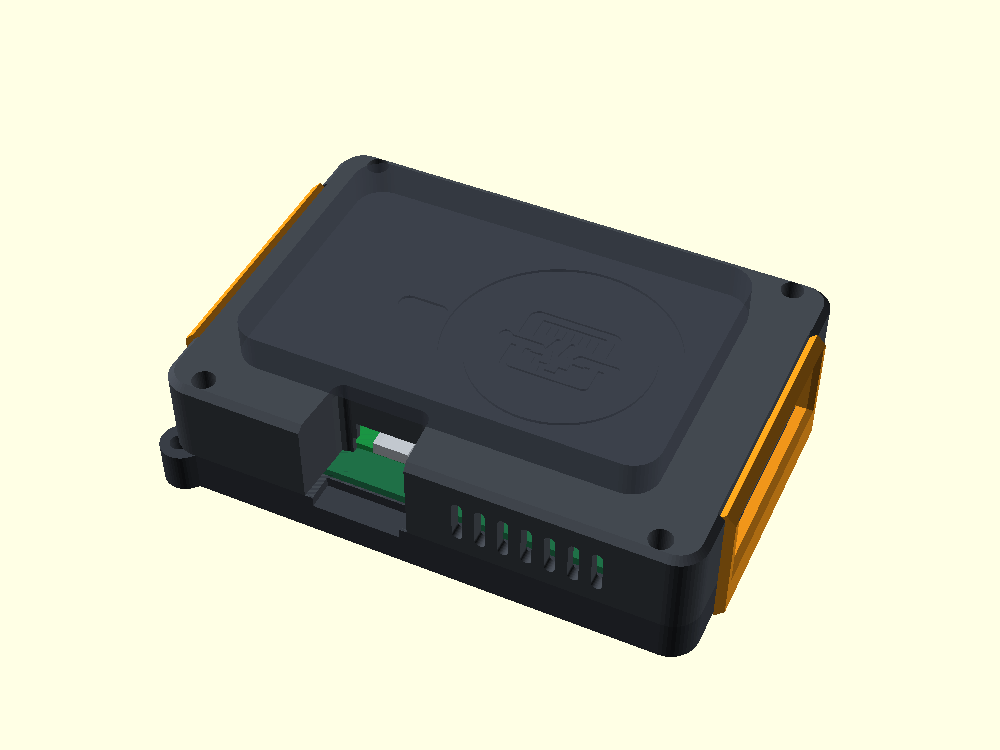
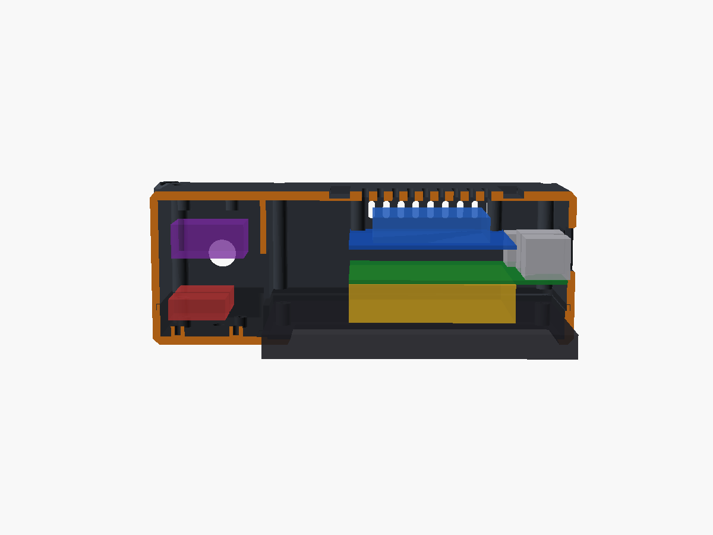

# JackTrace — Hardware, Enclosures, Setup & Developer Reference

This document covers physical hardware requirements, 3D-printable enclosures, Raspberry Pi 4 OS provisioning, systemd services, environment configuration, codebase architecture, REST/WebSocket endpoints, and the automated test suite.

> For Standard Mode user features see [**`docs/features.md`**](features.md).
> For Authorized Pentest Mode and Tailcat remote tunnels see [**`docs/pentest-and-remote.md`**](pentest-and-remote.md).

---

## 1. Hardware Stack

### Core Build (Zero Soldering Required)
- **Single-Board Computer:** **Raspberry Pi 4 Model B** (required for its onboard **Broadcom `BCM54213PE`** Gigabit Ethernet PHY, which supports Enhanced Cable Diagnostics hardware TDR over MDIO).
- **Display:** **Waveshare 5" DSI Capacitive Touchscreen (`800×480`)** connected via `15-pin` DSI ribbon cable (`dtoverlay=vc4-kms-dsi-7inch`).
- **Power:** Any stable `5 V / 3 A` USB-C power bank (or MagSafe slim power bank), **or** an internal PiSugar 3 Plus + Waveshare PoE HAT (C) stack (see Enclosures below).
- **Storage:** microSD card (`>= 16 GB`) running **Raspberry Pi OS Lite** (Bookworm or Trixie, 64-bit).

### Supported Optional Peripherals
- **USB 2.5GbE / Secondary Wired NIC** (e.g., Realtek `r8152` USB-C/USB-A adapter): Auto-enumerated in `SYS → NICs & TAP` for `2.5GbE` testing or paired with `eth0` for a transparent **Dual-NIC Inline Tap (`br0`)**.
- **58 mm Bluetooth Thermal Printer** (ESC/POS compatible): Paired via `LOG → BT PRINTER` for 1-tap wall-drop QR labels and live receipts.
- **Secondary USB Wi-Fi Adapter:** Auto-detected in Pentest Mode (`WIFI+`) alongside onboard `wlan0`.

---

## 2. 3D-Printable Enclosures & PoE Power Architecture

Two support-free OpenSCAD enclosures are included in this repository:

| Feature | Minimal Field Bumper | Extended-Grip Enclosure |
| :--- | :--- | :--- |
| **Dimensions (`L×H×D`)** | `137.6 × 93.0 × 38.5 mm` (`~47.5 mm` w/ MagSafe bank) | `173.3 × 96.0 × 63.3 mm` |
| **Hardware Stack** | Pi 4B + Waveshare 5" DSI LCD + stock `50 mm` ribbon | Pi 4B + Waveshare 5" DSI LCD (`150 mm` ribbon) + **PiSugar 3 Plus** (`5000 mAh`) + **Waveshare PoE HAT (C)** + **2× Ideal Diode OR-ing** + guarded `12 mm` power button |
| **MagSafe / Stand** | Flush rear groove for stick-on MagSafe ring + anti-spin pill | Integrated flush U-frame rear kickstand (`~55°` stand angle) + lanyard loop |
| **Slicer / Bed** | Support-free FDM (`180 × 180 mm` bed); optional TPU 95A rails | Support-free FDM (`180 × 100 mm` bed); PETG/ABS/ASA recommended |
| **Docs & STLs** | [`enclosure/minimal/01_field_bumper/README.md`](../enclosure/minimal/01_field_bumper/README.md) | [`enclosure/BUILD_GUIDE.md`](../enclosure/BUILD_GUIDE.md) |

<p align="center">
  
  &nbsp;&nbsp;
  
</p>

### Critical Electrical Rule if attempting PoE + UPS + Working TDR
To keep **Broadcom hardware TDR** working 100% accurately, avoid inline PoE splitters ahead of the RJ45 port — instead route `48 V` PoE directly off the Pi 4's MagJack 4-pin PoE header into the isolated **Waveshare PoE HAT (C)**:
1. **Isolate GPIO Pins 2 & 4 (`5 V`)** on the PoE HAT (C) so it never drives the Pi's 5 V GPIO rail simultaneously with the PiSugar 3 Plus.
2. Route the PoE HAT's isolated `5 V / 4 A` USB-A output through **Ideal Diode #1** (`LM74610` / `XL0401`, `<30 mV` drop), and external USB-C `5 V` through **Ideal Diode #2**, into the PiSugar 3 Plus `5 V IN`. This allows USB-C + 802.3af/at PoE to be connected together with **zero backfeed**.

---

## 3. Raspberry Pi 4 Provisioning Scripts

Run all setup scripts from the repository root (`~/jacktrace`) on Raspberry Pi OS Lite:

### Step 1 — Networking Backend & FastAPI Service ([`scripts/setup_pi.sh`](../scripts/setup_pi.sh))
```bash
sudo bash scripts/setup_pi.sh eth0
```
- Installs: `lldpd`, `ethtool`, `iproute2`, `iputils-ping`, `tcpdump`, `arp-scan`, `ieee-data`, `iw`, `iperf3`, `traceroute`, `bluez`, `nmap`, `python3-venv`, `python3-pip`.
- Configures `/etc/default/lldpd` (`DAEMON_ARGS="-c -e -f -s"`) for LLDP, LLDP-MED, Cisco CDP, Extreme EDP, Foundry FDP, and Nortel SONMP, plus `dot3 power pd` PoE Type 2 advertisement in `/etc/lldpd.d/nettester.conf`.
- Sets `net.ipv4.ip_forward=0` and disables `NetworkManager-wait-online.service` / `systemd-networkd-wait-online.service` so unplugged `eth0` never stalls boot.
- Downloads the latest [`tailcat`](https://github.com/tailscale/tailcat) binary to `/usr/local/bin/tailcat` when online (skipped gracefully if offline).
- Creates `.venv`, installs `requirements.txt`, and installs/starts `pi-nettester.service` on port `8080`.

### Step 2 — Touchscreen Wayland Kiosk ([`scripts/setup_kiosk.sh`](../scripts/setup_kiosk.sh))
```bash
sudo bash scripts/setup_kiosk.sh           # Standard 0° landscape
# or:
sudo bash scripts/setup_kiosk.sh --flip    # Flip display + touch 180°
```
- Configures `dtoverlay=vc4-kms-dsi-7inch` (with optional `,invx,invy`) in `/boot/firmware/config.txt`.
- Installs `cage`, `wlr-randr`, `seatd`, `libgl1-mesa-dri`, `fonts-dejavu-core`, `fonts-noto-color-emoji`, and `chromium`.
- Builds an isolated **transparent Xcursor theme** (`/usr/share/jacktrace-cursors`) so no mouse pointer lingers on top of the capacitive touchscreen UI under Cage `0.1.x` + Chromium.
- Installs `/usr/local/bin/jacktrace-kiosk-pre`, `/usr/local/bin/jacktrace-kiosk-launch`, `jacktrace-splash-handoff.service`, and `jacktrace-kiosk.service` on `tty1`, launching `http://127.0.0.1:8080/?kiosk=1`.

### Step 3 — Boot & Shutdown Logo Splash ([`scripts/setup_splash.sh`](../scripts/setup_splash.sh))
```bash
sudo bash scripts/setup_splash.sh
```
- Installs `plymouth` and configures the custom `800×480` theme from [`branding/logos/splash_800x480.png`](../branding/logos/splash_800x480.png).
- Adds `disable_splash=1` to `config.txt` (hides firmware rainbow square) and configures `console=tty3 quiet splash loglevel=3 logo.nologo vt.global_cursor_default=0 plymouth.ignore-serial-consoles` in `cmdline.txt`.
- Coordinates `jacktrace-splash-handoff.service` so Plymouth holds the boot logo cleanly until `http://127.0.0.1:8080/` responds, then executes `plymouth quit --retain-splash` straight into Chromium.

---

## 3b. x86_64 Linux & GPD Pocket 3 Setup

JackTrace also supports **x86_64 Linux** laptops and UMPCs — especially the **GPD Pocket 3** (`1920×1200` convertible touchscreen, built-in battery, Intel AX200/AX210 Wi-Fi 6/6E, Realtek RTL8125 2.5GbE).

- **Recommended Distro:** **Debian 13 (Trixie)** (Netinst / Minimal), which keeps full `.deb` package parity with Raspberry Pi OS (no Snap Chromium overhead) and includes a modern `6.12+` kernel for `r8169` (RTL8125) and `iwlwifi` (`firmware-iwlwifi`).
- **Provisioning Script ([`scripts/setup_x86.sh`](../scripts/setup_x86.sh)):**
  ```bash
  # Desktop launcher mode (opens Chromium/Chrome --app=http://127.0.0.1:8080/?mode=app)
  sudo bash scripts/setup_x86.sh --profile gpd-pocket3 --mode desktop

  # Or appliance Wayland kiosk mode (boots straight into JackTrace on tty1)
  sudo bash scripts/setup_x86.sh --profile gpd-pocket3 --mode kiosk
  ```
- **What `--profile gpd-pocket3` configures:**
  - Auto-detects predictable wired/wireless interface names (`enp*`/`eno*` and `wlp*`/`wlo*`).
  - Rotates the portrait-native panel (`fbcon=rotate:1 video=DSI-1:panel_orientation=right_side_up` in `/etc/default/grub.d/90-jacktrace-gpd-pocket3.cfg`) and applies the Goodix `libinput` touch matrix (`0 1 0 -1 0 1`) via `/etc/udev/rules.d/99-gpd-pocket3-touch.rules`.
  - Uses **`?mode=app`** responsive fullscreen mode (normal cursor, battery gauge in top bar, `6 GHz` Wi-Fi survey support, and hardware keyboard input inside `#kb-modal` with toggleable virtual keys).
- **Hardware TDR Caveat:** Onboard Realtek `RTL8125` (`r8169`) and common USB NICs (`r8152`, `ax88179_178a`) do not implement Linux `ethtool --cable-test` or Broadcom MDIO diagnostics; JackTrace safely detects non-Broadcom PHYs without issuing Broadcom register writes and hides Pi-only `DSI Flip` / `OverlayFS` toggles automatically.

---

## 4. Systemd Services & Persisted Data

### Services
| Unit File | User | Purpose |
| :--- | :--- | :--- |
| [`systemd/pi-nettester.service`](../systemd/pi-nettester.service) | `root` | Runs `.venv/bin/uvicorn app.main:app --host 0.0.0.0 --port 8080` after `network.target` and `lldpd.service` (`NETTESTER_DEMO=0`) |
| [`systemd/jacktrace-splash-handoff.service`](../systemd/jacktrace-splash-handoff.service) | `root` | Oneshot DRM handoff holding Plymouth splash until FastAPI listens on `:8080` |
| [`systemd/jacktrace-kiosk.service`](../systemd/jacktrace-kiosk.service) | Kiosk user | Runs Wayland `cage -s -- /usr/local/bin/jacktrace-kiosk-launch` on `tty1` with hidden cursor theme |

### Persistent `data/` Files
All runtime configuration and audit logs live under `data/` (excluded from `tar` deploys and `.gitignore`):
- `data/jacktrace_audit.db` — SQLite jobs, `wall_ports` test rows, and `sync_queue` offline retry entries
- `data/sync_settings.json` — Webhook URL/Bearer token, NetBox URL/API token, and auto-sync preferences
- `data/printer_settings.json` — Selected 58 mm Bluetooth printer MAC & name
- `data/tdr_settings.json` — Selected Cable Jacket label & NVP percentage (`55.0–85.0`)
- `data/vlan_settings.json` — Custom 802.1Q VLAN Trunk Prober presets
- `data/snmp_settings.json` — Last/saved SNMPv2c community string
- `data/original_macs.json` — Saved permanent hardware MACs for reliable MAC spoof recovery

---

## 5. Environment Variables

| Variable | Default | Description |
| :--- | :--- | :--- |
| `NETTESTER_IFACE` | Auto (`eth0` / `end0` / first wired NIC) | Primary wired Ethernet test interface |
| `NETTESTER_WIFI_IFACE` | Auto (`wlan0` or first wireless NIC) | Primary Wi-Fi interface for Survey, Client & Hotspot |
| `NETTESTER_HOST` | `0.0.0.0` | Uvicorn bind address |
| `NETTESTER_PORT` | `8080` | HTTP / WebSocket server port |
| `NETTESTER_DEMO` | `1` off-Linux, `0` on Linux | Set `1`/`true` to force simulated Demo Mode on Linux |
| `NETTESTER_POLL_SEC` | `2.0` | Background link/LLDP/PHY poll interval (seconds) |
| `NETTESTER_BLINK_MAX_SEC` | `180` | Auto-stop safety timeout for LED Port Blinker (seconds) |
| `NETTESTER_TDR_TICKS_PER_M` | `97.4` | Base Broadcom ECD raw ticks per meter at `69%` NVP (`Cat5e`) |

---

## 6. Codebase Architecture

### Python Backend (`app/`)
| Module | Responsibility |
| :--- | :--- |
| `main.py` | FastAPI application (`v2.0.4`), `TesterRuntime` background poll/retry loops, WebSocket broadcaster, REST API routes |
| `models.py` | Pydantic telemetry models (`TesterSnapshot`, `LinkTelemetry`, `PhyWiringState`, `TdrReportState`, `PentestState`, `TailcatState`, etc.) |
| `config.py`, `demo_data.py` | `Settings` dataclass (`NETTESTER_*` env vars), wired interface auto-detection, and 4 interactive demo scenarios |
| `probes.py`, `blinker.py`, `port_mapper.py` | `ethtool`/sysfs/LLDP/CDP/L3 telemetry probes, speed-cycle/link-pulse LED blinker, and 8/16/24/48-port switch faceplate parser |
| `tdr.py` | Raw Linux MDIO `BCM54213PE` hardware TDR (`0x0fc0..0x0fc5`), NVP calibration, IEEE `0x0A` + Broadcom `0x11`–`0x14` non-disruptive PHY wiring decoder |
| `sniffer.py`, `security.py` | Raw `AF_PACKET` L2/STP/DHCP/EAPOL/ARP sniffer, `.pcap` capture manager, Rogue DHCP probe, `0–100` (`A`–`F`) security scorer |
| `autotest.py`, `diagnostics.py` | 7-stage AutoTest engine (`Standard` & `LAN-Only`), Ping, Traceroute, PMTU/Jumbo discovery, `SO_BINDTODEVICE`-bound Cloudflare WAN Speed + Bufferbloat, `iperf3` |
| `vlan_probe.py`, `snmp_client.py` | Ephemeral `eth0.<vid>` 802.1Q trunk DHCP prober and pure-Python BER/ASN.1 SNMPv2c client |
| `scanner.py`, `oui_db.py`, `host_inspect.py` | `/24` ARP sweep + NetBIOS (`UDP/137`), offline IEEE OUI lookup, 17-port TCP Deep Dive, HTTP `<title>`, and Wake-on-LAN |
| `wifi_survey.py`, `wifi_client.py` | `iw` 2.4/5 GHz survey + 60-sample Signal Walk Meter, and `nmcli` `wlan0` client switcher |
| `audit.py`, `sync_client.py`, `printer.py` | SQLite wall-drop logger + `fpdf2` PDF/CSV/JSON exports + QR generator + Field AP toggle; Webhook/NetBox offline queue sync; BlueZ 58 mm ESC/POS printer |
| `net_config.py`, `dot1x.py`, `nic_tap.py`, `system_ctrl.py` | Non-persistent wired Static IPv4 (`nmcli`), ephemeral wired 802.1X EAP-PEAP tester (`wpa_supplicant`), Multi-NIC + `br0` Inline Tap, DSI backlight/flip/OverlayFS/power |
| `pentest_mode.py`, `pentest_recon.py`, `pentest_sniffer.py`, `pentest_nac.py`, `pentest_wifi.py`, `tailcat_mgr.py` | Authorized Pentest Mode state gate, bounded `nmap`/SNMP/TLS recon, passive LLMNR/NBT-NS/WPAD/cleartext exposure analyzer, MAC clone/spoof, USB Wi-Fi Rogue AP watch, Tailcat manager |

### Frontend (`static/`)
- `index.html` — Single-page `800×480` instrument UI + modals (`host-modal`, `sys-modal`, `pentest-gate-modal`, `pdf-modal`, `kb-modal`) + desktop Bench Bar (`#bench-bar`)
- `style.css` — Dark hardware aesthetic (`#101114`), cyan/emerald Standard accent + crimson Pentest theme, touch target sizing, zero-scroll layouts
- `app.js` — Real-time WebSocket client (with REST polling fallback), canvas rendering (Ping sparkline, Bufferbloat meter, 2.4/5 GHz channel overlap graph, SVG 4-pair Wiremap), touch keyboard controller

---

## 7. REST & WebSocket API Overview

| Group | Endpoints |
| :--- | :--- |
| **UI & Live Stream** | `GET /`, `WS /ws`, `GET /api/snapshot`, `POST /api/rescan`, `POST /api/mode` |
| **Link, TDR & PHY** | `POST /api/tdr/run`, `POST /api/tdr/calibration`, `POST /api/stress`, `POST /api/phy/reset-counters` |
| **Switch, Blink, VLAN & SNMP** | `POST /api/blink/toggle`, `POST /api/vlan/presets`, `POST /api/vlan/probe`, `POST /api/snmp/query` |
| **AutoTest & Path Diagnostics** | `POST /api/autotest/config`, `POST /api/autotest/run`, `POST /api/diag/ping/start`, `POST /api/diag/ping/stop`, `POST /api/diag/traceroute`, `POST /api/diag/speedtest`, `POST /api/diag/mtu`, `POST /api/diag/iperf/client`, `POST /api/diag/iperf/server`, `POST /api/diag/iperf/targets` |
| **Subnet Scan & Deep Dive** | `POST /api/scan/start`, `POST /api/host/inspect`, `POST /api/host/wol` |
| **Wi-Fi Survey & Client** | `POST /api/wifi/scan`, `POST /api/wifi/walk/start`, `POST /api/wifi/walk/stop`, `GET /api/wifi/client/status`, `POST /api/wifi/client/scan`, `POST /api/wifi/client/connect`, `POST /api/wifi/client/disconnect`, `POST /api/wifi/client/forget` |
| **Security & Forensics** | `POST /api/security/probe`, `POST /api/audit/pcap/start`, `POST /api/audit/pcap/stop`, `GET /api/audit/latest.pcap`, `POST /api/sniffer/clear-exposure` |
| **Audit, Sync & BT Printer** | `POST /api/audit/save`, `POST /api/audit/job`, `POST /api/audit/job/switch`, `POST /api/audit/prefix`, `POST /api/audit/port/{row_id}/notes`, `GET /api/audit/report.pdf`, `GET /api/audit/report.csv`, `GET /api/audit/report.json`, `POST /api/audit/hotspot`, `POST /api/sync/config`, `POST /api/sync/test-netbox`, `POST /api/sync/push-job`, `POST /api/sync/flush`, `POST /api/sync/queue/clear`, `POST /api/printer/scan`, `POST /api/printer/select`, `POST /api/printer/print-live`, `POST /api/printer/print-port/{row_id}` |
| **Network, 802.1X, Multi-NIC & System** | `POST /api/net/ipv4/static`, `POST /api/net/ipv4/dhcp`, `POST /api/dot1x/start`, `POST /api/dot1x/stop`, `GET /api/nics/list`, `POST /api/nics/select`, `POST /api/tap/toggle`, `POST /api/system/backlight`, `POST /api/system/orientation`, `POST /api/system/overlayfs`, `POST /api/system/power` |
| **Authorized Pentest Mode** *(requires `enabled=true`)* | `GET /api/pentest/status`, `POST /api/pentest/mode`, `POST /api/pentest/preflight`, `POST /api/pentest/recon/start`, `POST /api/pentest/recon/stop`, `POST /api/pentest/recon/clear`, `POST /api/pentest/mac/spoof`, `POST /api/pentest/mac/restore`, `POST /api/pentest/wifi/watch` |
| **Tailcat Remote Access** | `GET /api/tailcat/status`, `POST /api/tailcat/start`, `POST /api/tailcat/stop`, `POST /api/tailcat/webhook` |

---

## 8. Local Development, Deployment & Tests

- **Run Local Demo Server:**
  ```powershell
  .\.venv\Scripts\uvicorn app.main:app --host 0.0.0.0 --port 8080
  ```
- **Deploy Updates to Raspberry Pi 4 (Windows PowerShell):**
  ```powershell
  cmd /c "tar --exclude=.venv --exclude=.pytest_cache --exclude=__pycache__ --exclude=data -czf - . | ssh jacktrace ""mkdir -p ~/jacktrace && tar -xzf - -C ~/jacktrace""" ; if ($LASTEXITCODE -eq 0) { ssh jacktrace "sudo systemctl restart pi-nettester.service jacktrace-kiosk.service && sleep 3 && systemctl is-active pi-nettester jacktrace-kiosk" }
  ```
- **Run Automated Tests (**52 tests** across `tests/test_phase1.py`–`tests/test_phase3.py`, `tests/test_m1.py`–`tests/test_m4.py`, `tests/test_pentest_phase1.py`–`tests/test_pentest_phase3.py`, `tests/test_wifi_client.py`, and `tests/test_v21_features.py`):**
  ```powershell
  .\.venv\Scripts\python.exe -m pytest -v
  ```
