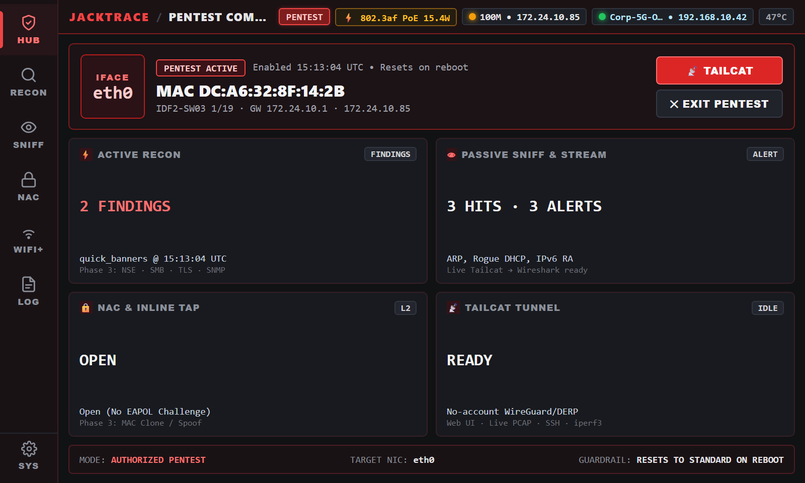
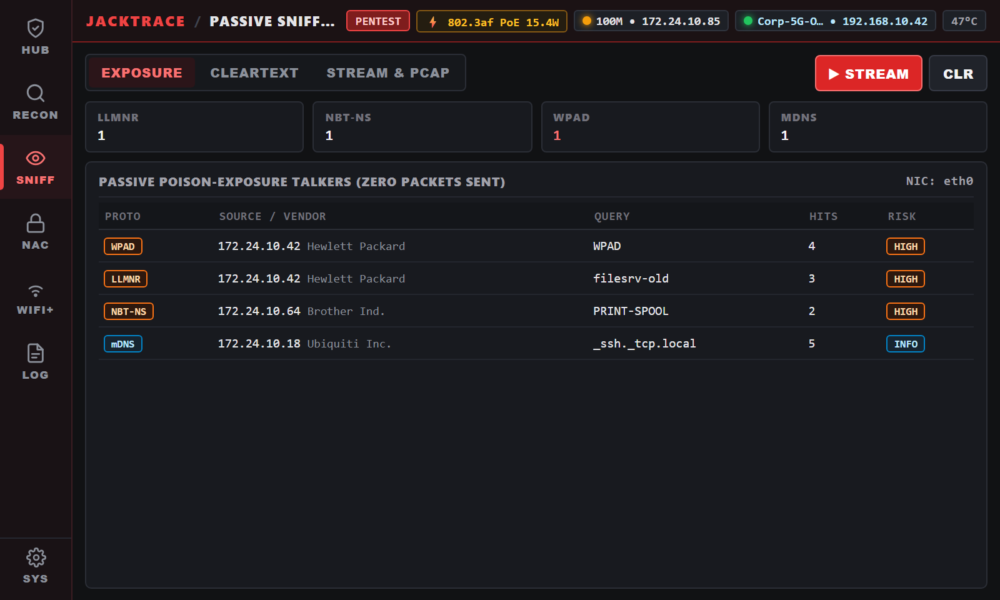

# JackTrace — Authorized Pentest Mode & Tailcat Remote Access

JackTrace includes an opt-in **Authorized Pentest Mode** and zero-account **Tailcat WireGuard/DERP Remote Tunnels**, allowing field engineers and authorized penetration testers to switch from daily diagnostics into a dedicated crimson security workbench — or stream live packets, Web UI, `iperf3`, and key-authenticated SSH back to a remote laptop over NAT/firewalls.

> For Standard Mode diagnostics (`LIVE`, `PORT`, `TDR`, `PATH`, `SCAN`, `WIFI`, `SEC`, `LOG`) see [**`docs/features.md`**](features.md).
> For hardware builds, provisioning, and full API reference see [**`docs/hardware-and-setup.md`**](hardware-and-setup.md).

---

## Authorization Gate & Safety Architecture

Authorized Pentest Mode is engineered with hard operational guardrails so it cannot be triggered accidentally:

1. **Always Off on Boot:** `PentestModeManager` initializes `enabled = False` on every service start or Raspberry Pi reboot.
2. **Explicit Confirmation Modal:** Tapping the topbar `LIVE` pill opens a confirmation warning stating that active auditing tools must only be used on networks with ownership or explicit written authorization (`POST /api/pentest/mode` requires `authorized_ack: true`, returning `HTTP 400` otherwise).
3. **Server-Side Route Enforcement:** Every active recon and MAC-spoof API endpoint calls `_require_pentest_mode()`, returning **`HTTP 403`** whenever Pentest Mode is inactive.
4. **Automatic Cleanup on Exit / Mode Switch:** Disabling Pentest Mode (or switching NIC / Demo scenario via `POST /api/mode`) automatically:
   - Terminates any running `nmap` / recon subprocess
   - Restores the original permanent hardware MAC address
   - Tears down active `pcap_stream` Tailcat tunnels or `br0` Inline Tap bridges when changing interfaces

When active, the entire instrument swaps to a high-contrast crimson accent theme and replaces the Standard Mode rail with 6 Pentest views: **`HUB`**, **`RECON`**, **`SNIFF`**, **`NAC`**, **`WIFI+`**, and **`LOG`**.

---

## `01` `HUB` — Crimson Command Hub

  

- **Interface Hero Card:** Displays the active wired interface, current vs. spoofed MAC badge, upstream LLDP/CDP switch & gateway summary, and quick **`TAILCAT`** + **`✕ EXIT PENTEST`** controls.
- **`2×2` Status Tiles:**
  - **Active Recon:** Discovered host count + active audit finding summary (jumps to `RECON`)
  - **Passive Sniff & Stream:** Live alert counter + exposure status (jumps to `SNIFF`)
  - **NAC & Inline Tap:** `br0` tap bridge, 802.1X EAPOL, and MAC spoof state (jumps to `NAC`)
  - **Tailcat Tunnel:** Current tunnel mode/status (`Idle` or `Listening`, jumps to `SYS → REMOTE`)

---

## `02` `RECON` — Active Host & Service Auditing

Runs bounded, non-destructive service and misconfiguration audits against a single IPv4 host or an IPv4 CIDR block (`>= /24`), capped at **`16` hosts** and a **`45 s` execution timeout** with strict input validation (`validate_recon_target` rejects shell metacharacters and subnets larger than `/24`).

### Supported Audit Profiles
| Profile Chip | Scanner / Method | Findings Flagged |
| :--- | :--- | :--- |
| **`Quick Banners`** | `nmap -sV --top-ports 25 -T4 --host-timeout 12s` *(pure-Python TCP banner fallback across ports `21, 22, 23, 80, 443, 445, 3389, 8080` if `nmap` is missing)* | `WARN` on cleartext **FTP (:21)**, **Telnet (:23)**, and **unencrypted HTTP (:80/:8080)** admin interfaces; `INFO` service/version banners for other open ports |
| **`SMB Signing`** | `nmap -p 139,445 --script smb-security-mode,smb2-security-mode,smb-protocols -T4` | `CRITICAL` if **legacy SMBv1** (`nt lm 0.12`) is enabled; `HIGH` if **SMB signing is disabled or not required** (NTLM relay exposure); `INFO` when signing is enforced |
| **`TLS / Certs`** | `nmap -p 443,8443 --script ssl-enum-ciphers,ssl-cert -T4` *(pure-Python `ssl` fallback on `:443, :8443` if `nmap` is missing)* | `HIGH` for deprecated protocols/ciphers (**TLSv1.0, TLSv1.1, SSLv3, RC4, NULL, EXPORT**); `WARN` for **self-signed** certificates; `INFO` for certificate metadata |
| **`SNMP Defaults`** | Pure-Python stdlib SNMPv2c `GetRequest` (`sysName` + `sysDescr`) testing `"public"`, `"private"`, `"community"` | `CRITICAL` if **`private`** responds; `HIGH` if **`public`** or **`community`** responds |

### `TARGETS` Sub-Tab
Lists all hosts already discovered by the `/24` Subnet Scanner so you can tap any row to target it directly (or launch a new `/24` ARP sweep) without typing IPs on the touchscreen.

---

## `03` `SNIFF` — Passive Exposure, Cleartext Alerts & Live Stream

  

Runs inside JackTrace's `AF_PACKET` Layer-2 sniffer, analyzing live Ethernet/IPv4/IPv6 traffic with **zero packets transmitted** on the wire.

### `EXPOSURE` Sub-Tab (Zero-Packet Poison-Exposure Watch)
Detects hosts broadcasting legacy name-resolution queries vulnerable to on-link responder/poisoning attacks (capped & deduplicated up to `60` active talkers with MAC OUI vendor attribution and hit counts):
- **LLMNR** (`UDP/5355`) — `HIGH` risk
- **NBT-NS** (`UDP/137`, RFC 1001/1002 first-level NetBIOS name decoder) — `HIGH` risk
- **WPAD** (`wpad` / `wpad.*` via LLMNR, NBT-NS, or mDNS) — `HIGH` risk
- **mDNS** (`UDP/5353`) — `INFO` visibility (excluding generic `_services._dns-sd` browse noise)

### `CLEARTEXT` Sub-Tab (Credential Redaction Built In)
Passively inspects L4 headers/payloads for cleartext authentication and legacy unencrypted protocols (deduplicated up to `50` severity-ranked alerts). **Non-default passwords, Bearer tokens, and community strings are always redacted** (never stored or displayed in plaintext):
- **HTTP Basic Auth** (`Authorization: Basic` on `:80, 8000, 8080, 8081, 8888`) — `CRITICAL` (logs username + redacted password length)
- **HTTP Bearer Token & Cleartext POST Passwords** (`password=` / `passwd=` / `pwd=`) — `HIGH` (redacted)
- **FTP** (`USER` / `PASS` on `TCP/21`) — `CRITICAL` (`PASS` value redacted)
- **Telnet** (`TCP/23`) — `HIGH`
- **SNMPv1 / SNMPv2c** (`UDP/161, 162` BER/ASN.1 parser) — `HIGH` (redacts non-default strings; explicitly notes known defaults like `'public'`/`'private'`)
- **NTLMSSP Handshake** (`NTLMSSP\x00` Type `1`, `2`, `3` anywhere in TCP stream, e.g. SMB `:445` or HTTP NTLM) — `HIGH` (Types 1–2) / `CRITICAL` (Type 3 response)
- **Legacy SMBv1 Negotiation** (`\xffSMB` on `TCP/139, 445`) — `HIGH`
- **Cleartext Mail Auth** (`USER`, `PASS`, `AUTH PLAIN`, `LOGIN` on SMTP/POP3/IMAP `:25, 110, 143, 587`) — `CRITICAL` (redacted)
- **Unencrypted MQTT** (`CONNECT` on `TCP/1883`) & **SIP** (`REGISTER` / `Authorization:` on `UDP/5060`) — `WARN`

### `STREAM & PCAP` Sub-Tab
- **Live Tailcat → Wireshark Stream:** Starts an ephemeral `tcpdump -i <iface|br0> -U -s 0 -w - | tailcat` pipe and renders both the scannable QR code and copy-ready Wireshark pipe command (`tailcat <addr> | wireshark -k -i -`).
- **Local `.pcap` Recorder:** 1-tap `15s`, `60s`, or continuous capture (`100 MB` ring safety limit) with direct `/api/audit/latest.pcap` download.

---

## `04` `NAC` — Dual-NIC Inline Tap, 802.1X & MAC Clone/Spoof

### Dual-NIC Inline Tap (`br0`) & 802.1X Readout
- Bridges two physical wired NICs (for example onboard `eth0` + a USB `2.5GbE` adapter) into a transparent Layer-2 bridge (`br0`) placed between a wall jack and a corporate workstation/phone/printer.
- Sets bridge `group_fwd_mask=0x4008` so **LLDP** and **802.1X EAPOL** authentication frames pass transparently between switch and client while `PassiveL2Sniffer("br0")` and `tcpdump` capture both sides cleanly.
- Enforces `net.ipv4.ip_forward=0` and always destroys `br0` cleanly on toggle off, mode change, or shutdown.
- Includes a 1-tap jump to JackTrace's built-in **802.1X EAP-PEAP/TTLS Supplicant Tester** (`SYS → IP & CAL`).

### Safe Temporary MAC Clone & Spoof
- Persists each adapter's permanent hardware MAC (`ethtool -P` / sysfs) into `data/original_macs.json` **before** applying any change.
- Validates unicast formatting (rejects multicast, all-zeros, and broadcast MACs) and refuses execution while a `br0` Inline Tap is active (`HTTP 409`).
- **3 Touch Actions:**
  - **🎭 Clone:** Picks any host discovered on the subnet (e.g., an authorized printer or IP phone) and applies its MAC to the active wired interface (`ip link set dev <iface> address <mac>`).
  - **🎲 Random:** Generates a valid locally-administered unicast MAC.
  - **✎ Custom:** Enters any unicast MAC via the touch keyboard.
- **↩ Restore & Rollback:** 1-tap hardware MAC restoration, automatic rollback if `ip link` fails mid-operation, and automatic restoration whenever Pentest Mode is exited or interfaces are switched.

---

## `05` `WIFI+` — External USB Wi-Fi & Rogue AP / Evil Twin Watch

- **Secondary USB Radio Detection (`detect_usb_wifi_iface`):** Automatically detects any external USB wireless interface alongside onboard `wlan0` (which remains available for survey + client Wi-Fi management).
- **Target Watch SSID:** Tap `Watch:` to enter a corporate/venue SSID.
- **Passive Evil Twin & Security Anomaly Detection (`analyze_wifi_rogues`):** Evaluates every `iw` survey sweep and highlights:
  - **Weak/Deprecated Security:** `WEP`, `WPA-TKIP`, or `Open` networks (`CRITICAL` if matching Watch SSID, `HIGH`/`WARN` otherwise)
  - **Evil Twin Security Mismatch (`CRITICAL`):** Same SSID advertising mixed encryption families (e.g., `WPA2`/`WPA3` alongside `Open`/`WEP`/`TKIP`)
  - **Unexpected Multi-Vendor OUI (`HIGH` / `CRITICAL` on Watch SSID):** Same SSID broadcast by BSSIDs belonging to different hardware manufacturers

---

## Remote Access — Ephemeral Tailcat WireGuard/DERP Tunnels (`SYS → REMOTE`)

JackTrace integrates [`tailcat`](https://github.com/tailscale/tailcat) so you can drop the tester at a remote site or patch cabinet and reach it from your laptop **without creating VPN accounts, managing tailnet ACLs, or configuring port forwarding** — just install `tailcat` on your laptop and pass the ephemeral `tc...` WireGuard/DERP address shown on JackTrace's screen.

### Supported Tunnel Modes
| Mode | What Runs on JackTrace | Client Command on Your Laptop |
| :--- | :--- | :--- |
| **`Web UI`** (`web_ui`) | `tailcat serve 8080` | `tailcat forward <addr> 18080:8080` *(then open `http://localhost:18080`)* |
| **`Live PCAP`** (`pcap_stream`) | `tcpdump -i <eth0\|br0> -U -s 0 -w - \| tailcat` | `tailcat <addr> \| wireshark -k -i -` |
| **`iPerf3`** (`iperf`) | `tailcat serve 5201` | `tailcat forward <addr> 5201:5201` |
| **`SSH`** (`ssh`) | `tailcat serve --ssh-authorized-keys=<path> ssh` | `tailcat ssh <addr>` |

### Remote Tunnel Guardrails & Conveniences
- **Key-Only SSH:** `tailcat ssh` refuses to start unless a non-empty `authorized_keys` file already exists (`~/.ssh/authorized_keys` on the Pi); password SSH is never enabled.
- **On-Screen QR & Webhook Push:** Every active tunnel generates a scannable `tc...` QR code on the touchscreen plus a 1-tap **`📤 Push Address to Webhook`** button (`POST /api/tailcat/webhook`), sending a `jacktrace.tailcat_session` JSON event to your configured Webhook (Slack/Discord/Home Assistant/automation server) with the mode, address, and copy-ready client command.
- **Demo Mode Simulation:** Off-Pi desktop testing simulates Tailcat sessions end-to-end (`tcDemoJackTrace...`) so UI, QR codes, and webhook payloads can be verified without Linux `tailcat` installed.
